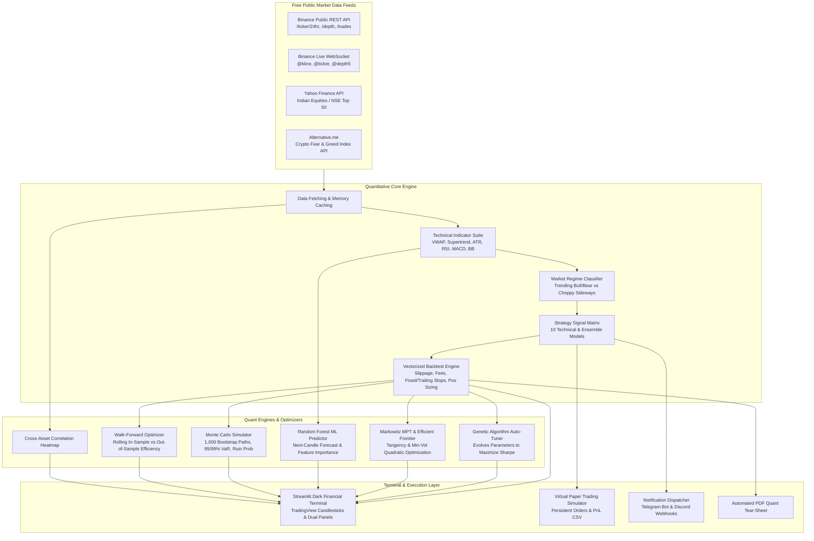

# ⚡ CurrencyKartz — Quantitative Trading & Algorithmic Research Terminal

<div align="center">

[](https://www.python.org/)
[](https://streamlit.io/)
[](https://www.docker.com/)
[](https://docs.pytest.org/)
[](LICENSE)
[]()

**An institutional-grade, zero-cost quantitative trading research and paper execution platform for Cryptocurrency (Binance) and Indian Equities (NSE).**

</div>

---

## 📌 Overview

**CurrencyKartz** is a quantitative finance framework and interactive financial terminal designed for researching, stress-testing, and virtual-trading algorithmic strategies.

Unlike standard hobbyist bots, CurrencyKartz emphasizes mathematical rigor:
- **Zero-Cost Architecture**: Built entirely on free, open public APIs (no Binance API key or subscription required).
- **Dual-Asset Pipelines**: Real-time Binance REST & WebSocket streams + Indian NSE stock data.
- **Genetic Algorithm (GA) Auto-Tuner**: Discovers optimal strategy parameters using natural selection across generations.
- **Markowitz Modern Portfolio Theory (MPT)**: Computes the Tangency (Max Sharpe) and Minimum Volatility portfolios across 2,000 Monte Carlo frontier simulations.
- **Machine Learning Direction Predictor**: Random Forest classifier predicting next-candle direction with feature importance ranking.
- **Institutional Risk Models**: 1,000-path Monte Carlo stress-testing, 95%/99% Value at Risk (VaR), and Walk-Forward rolling validation.
- **HFT Micro-Structure Virtual Tester**: Zero-risk high-frequency tester simulating Level-2 Order Book Imbalance (OBI) scalping with realistic taker fees.
- **Paper Trading Engine**: Virtual cash wallet simulation with real-time PnL, open position tracking, and CSV persistence.
- **Automated Alerts**: Direct push notifications to Telegram Bot & Discord Webhooks.

---

## 🏛️ System Architecture



---

## ✨ Key Platform Features

### 1. 📊 Dual Market & Live Data Ingestion
- **Binance Public REST API**: Real-time 24h ticker metrics, live depth book (bids/asks), order book spread, and recent trade ticks.
- **Binance WebSockets (`binance_ws.py`)**: Async multi-stream client with automatic reconnection logic for sub-second candle and ticker updates.
- **Indian Stocks (NSE)**: Full support for top Indian equities (Reliance, TCS, HDFC Bank, Infosys, etc.) via Yahoo Finance.
- **Alternative.me Sentiment API**: Live Crypto Fear & Greed index classification integrated into trading filters.

### 2. 🧠 Strategy Library (10 Models)
1. **Regime-Filtered MA Crossover**: Dynamic EMA crossover executing only when ADX/regime confirms a trend.
2. **Supertrend Trend-Following**: ATR-based adaptive trailing volatility band model.
3. **VWAP Crossover**: Institutional volume-weighted average price breakout & pullback system.
4. **Sentiment-Filtered MA**: Combines Fear & Greed sentiment with technical indicators.
5. **Weighted Custom Ensemble**: Configurable weighted voting across 6 core technical models.
6. **RSI Mean-Reversion**: Overbought/oversold counter-trend model.
7. **Bollinger Bands**: Volatility mean-reversion with dynamic bandwidth filters.
8. **MACD Crossover**: Momentum divergence and signal line crosses.
9. **Volume-Confirmed Breakout**: 20-day high breakouts validated by volume surges.
10. **Buy & Hold (Baseline Benchmark)**: Built-in control baseline for alpha calculation.

### 3. 🔬 Institutional Stress-Testing & Overfitting Protection
- **Monte Carlo Simulator (`monte_carlo.py`)**: Resamples historical trade returns across 1,000 paths to compute **95% & 99% Value at Risk (VaR)** and **Ruin Probability** (>30% drawdown).
- **Walk-Forward Optimizer (`walk_forward.py`)**: Tests rolling Train (In-Sample) vs Test (Out-of-Sample) windows to detect curve-fitting and calculate strategy **Efficiency Ratios**.
- **Cross-Asset Correlation Matrix**: Interactive Plotly heatmap assessing portfolio diversification across assets.
- **Head-to-Head Comparative Backtest**: Side-by-side equity overlay tool comparing up to 3 strategies simultaneously.

### 4. 📝 Paper Trading & Alert Dispatcher
- **Virtual Paper Wallet (`paper_trading.py`)**: $10,000 initial virtual cash, market BUY/SELL order simulation, live open position tracking, and persistent CSV storage.
- **Instant Alerts (`alerts.py`)**: Webhook triggers pushing signal alerts directly to Telegram channels and Discord servers.
- **Quant Tear-Sheet Reports (`reports.py`)**: 1-click downloadable PDF reports summarizing Sharpe, Sortino, Calmar ratios, and equity metrics.

---

## 🚀 Quickstart Guide

### Option A: Local Run (Python)

```bash
# 1. Clone the repository
git clone https://github.com/kartikkalliyan/CurrencyKartz.git
cd CurrencyKartz

# 2. Create virtual environment & install dependencies
python -m venv .venv
# On Windows:
.venv\Scripts\activate
# On Linux/macOS:
source .venv/bin/activate

pip install -r requirements.txt

# 3. Launch the financial terminal
python -m streamlit run app.py
```

### Option B: Docker (1-Command Launch)

No local Python setup required!

```bash
# Launch containerized terminal
docker compose up -d

# Open in your browser:
# http://localhost:8501
```

To stop the container:
```bash
docker compose down
```

### Option C: Free Streamlit Cloud Deployment (100% Free)
1. Fork or push this repository to your GitHub account.
2. Visit [share.streamlit.io](https://share.streamlit.io) and log in with GitHub.
3. Select your repository, set branch to `main`, and main file to `app.py`.
4. Click **Deploy** — your live terminal will be live at `https://<your-username>-currencykartz.streamlit.app`!

---

## 🧪 Comprehensive Unit Testing

CurrencyKartz includes a rigorous test suite covering network clients, indicator calculations, backtesting logic, risk management, and Monte Carlo models:

```bash
python -m pytest tests/ -v
```

All 72 tests run with mocked network dependencies, allowing clean offline execution in CI/CD environments.

---

## 📂 Project Structure

```text
├── .github/workflows/
│   └── test.yml                 # Automated GitHub Actions CI/CD pipeline
├── Dockerfile                   # Production Python 3.11 container image
├── docker-compose.yml           # Docker service definition
├── requirements.txt             # Python dependencies
├── app.py                       # Modern 6-Tab Streamlit Financial Terminal
├── config.py                    # Asset universe, risk styles & strategy registry
├── core_logic.py                # Quant decision engine & comparative backtest
├── backtest.py                  # Vectorized backtesting engine (fees, slippage, stops)
├── metrics.py                   # Sharpe, Sortino, Calmar, MaxDD, CAGR calculations
├── indicators.py                # Technical indicator suite (VWAP, Supertrend, ATR, etc.)
├── regime_detector.py           # Market regime classification (Trend vs Chop)
├── binance_market.py            # Free Binance public REST API wrapper
├── binance_ws.py                # Free Binance WebSocket streaming client
├── fear_greed.py                # Crypto Fear & Greed index parser
├── monte_carlo.py               # 1,000-path Monte Carlo & VaR engine
├── walk_forward.py              # Walk-Forward rolling train/test validator
├── paper_trading.py             # Virtual paper trading account engine
├── alerts.py                    # Telegram & Discord push notification dispatcher
├── display_helpers.py           # Plotly TradingView candlesticks, fan charts & CSS
├── reports.py                   # PDF tear-sheet export generator
├── strategy_*.py                # 10 modular trading strategy files
└── tests/                       # Comprehensive Pytest suite (72 unit tests)
```

---

## 📄 License

Distributed under the **MIT License**. See `LICENSE` for more information.

---

<div align="center">
Developed by <b>Kartik Kalliyan</b> • Built with Python & Streamlit
</div>
